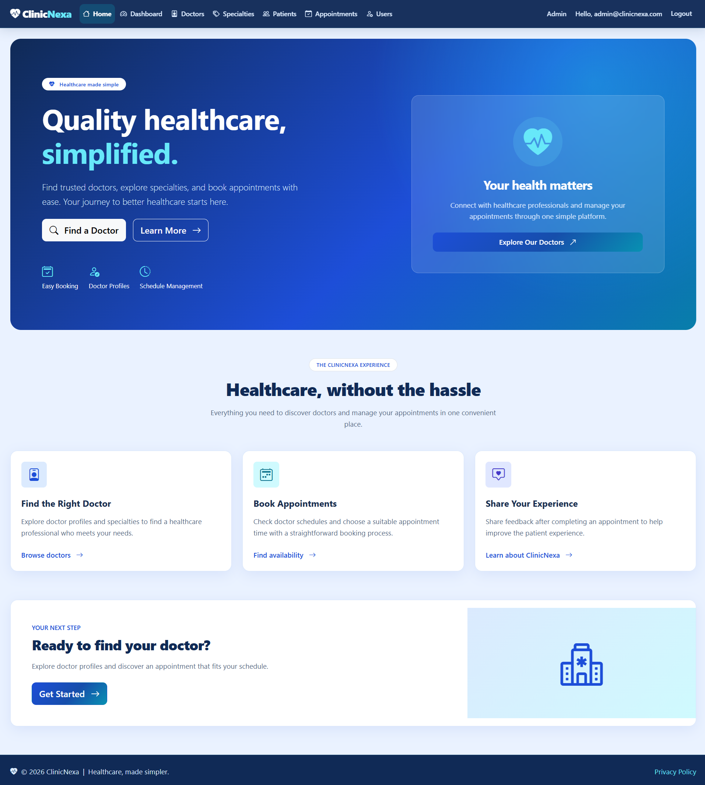
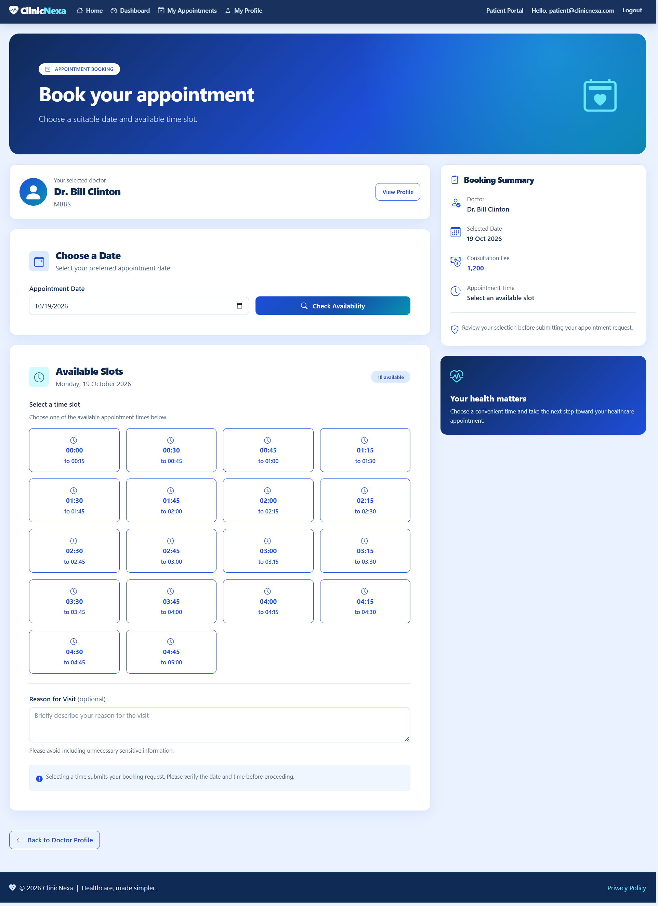
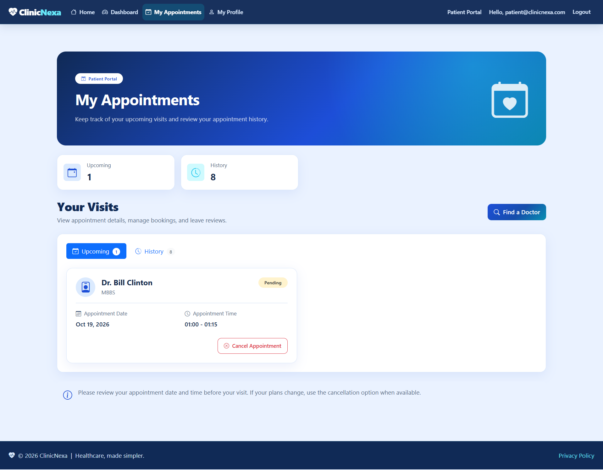

# ClinicNexa

**ClinicNexa** is a modern, responsive healthcare management platform built with ASP.NET Core MVC. It provides a simple platform for managing doctors, patients, specialties, schedules, appointments, and reviews.

The project is designed as a portfolio application demonstrating practical ASP.NET Core MVC development, Entity Framework Core, ASP.NET Core Identity, role-based authorization, database design, validation, and responsive UI development.

## Screenshots

### Home Screen
Register as Patient, Browse doctors, Book appointments.



### Administrator Dashboard
Manage doctors, patients, specialties, and appointments.


### Doctor Listing
Browse doctors, explore specialties, and view doctor profiles.


### Doctor Schedule Management
Configure working hours and manage schedule availability.


### Admin Patient Management
Configure working hours and manage schedule availability.


### Book Appointments
Patient browse doctors and book appointments.



### Patient Appointments Listing
Patient can view his/her appointments and leave review.



## Features

### Public

* Browse and search doctors
* View doctor profiles and specialties
* View doctor availability
* User registration and login
* Responsive healthcare-focused UI

### Patient

* Patient dashboard
* Manage personal profile
* Search doctors
* View doctor details
* Book appointments
* View upcoming and past appointments
* Cancel upcoming appointments
* Submit reviews for completed appointments

### Doctor

* Doctor dashboard
* Manage professional profile
* Manage specialties
* Configure availability/schedules
* View upcoming appointments
* View appointment history
* View patient appointment information
* View reviews

### Administrator

* Admin dashboard
* Manage doctors
* Manage patients
* Manage specialties
* Manage doctor schedules
* Manage appointments
* Manage users and roles

## Technology Stack

| Technology | Purpose |
|---|---|
| C# / ASP.NET Core MVC | Server-rendered web application |
| Entity Framework Core | Data access and ORM |
| SQLite | Lightweight relational database |
| ASP.NET Core Identity | Authentication and user management |
| Role-based authorization | Restrict access by user role |
| Bootstrap 5 | Responsive UI |
| HTML, CSS, JavaScript | Frontend presentation and interactions |
| Git / GitHub | Version control and source hosting |

## Architecture

ClinicNexa uses a straightforward MVC architecture with business operations organized into services where appropriate.

```text
Browser
   |
   v
ASP.NET Core MVC
   |
   +-- Controllers
   |
   +-- Views
   |
   +-- Services
   |      |
   +------+
          |
          v
   Entity Framework Core
          |
          v
        SQLite
```

The application uses server-rendered MVC views and does not require a separate frontend application, Web API, or microservices infrastructure.

## Database

### Business Tables

Business entities include:

* Doctors
* Specialties
* DoctorSpecialties
* Patients
* DoctorSchedules
* Appointments
* Reviews

ASP.NET Core Identity manages its own authentication and authorization tables.

### Appointment Slots

Appointment slots are generated dynamically from a doctor's schedule and appointment duration.

Existing appointments are checked to determine whether a generated slot is available or booked.

No separate `AppointmentSlots` table is required.

## Roles

| Role        | Description                                              |
| ----------- | -------------------------------------------------------- |
| **Admin**   | Manages the overall system                               |
| **Doctor**  | Manages profile, specialties, schedules and appointments |
| **Patient** | Searches doctors and manages appointments                |

## Seed Data

The application will automatically seed:

* Roles
* Admin account
* Doctor accounts
* Patient accounts
* Specialties
* Doctors
* Doctor schedules
* Sample appointments
* Sample reviews

This allows the application to be explored immediately after setup.

## Running Locally

## Prerequisites

- .NET SDK compatible with the project target framework
- Git
- A terminal or IDE such as Visual Studio

SQLite is included as a local database option, so no separate database server is required.

### 1. Clone the repository

```bash
git clone <repository-url>
cd clinicnexa
```

### 2. Restore dependencies

```bash
dotnet restore ClinicNexa.sln
```

### 3. Apply database migrations

From the solution root:

```bash
dotnet ef database update --project ClinicNexa.Web
```

If the EF Core CLI is not installed, install it using the official .NET tooling instructions. Ensure the EF Core tools version is compatible with the project.

### 4. Run the application

```bash
dotnet run --project ClinicNexa.Web
```

Open the local URL shown in the terminal.

The application uses the SQLite connection string in `appsettings.json`. Database initialization and seed behavior depend on the application's startup configuration.

## Demo Accounts

The application seeds sample users for local exploration. Use the demo credentials configured in the seed-data code.

**Important:** Demo credentials are for local development only. Never reuse them in a production environment or deploy publicly accessible accounts with known passwords.

| Role | Username / Email | Password |
|---|---|---|
| Admin | admin@clinicnexa.com | Admin@123 |
| Doctor | doctor@clinicnexa.com | Doctor@123 |
| Patient | Patient@clinicnexa.com | Patient@123 |

## Project Goals

ClinicNexa demonstrates:

- ASP.NET Core MVC application development
- Separation of controller responsibilities and business services
- Entity Framework Core and relational data modeling
- Authentication and role-based authorization
- CRUD workflows and server-side validation
- Appointment and schedule business rules
- Database migrations and seed data
- Responsive, role-specific user interfaces

## Scope and Future Enhancements

ClinicNexa focuses on appointment management rather than being a full electronic medical records system.

Potential future enhancements include:

- Automated tests
- Continuous integration with GitHub Actions
- Deployment documentation
- Notifications
- Medical records and prescriptions
- Billing and lab reports

## License

Add a license file if you intend to distribute the project under an open-source license. Otherwise, the repository is presented for educational and portfolio purposes.